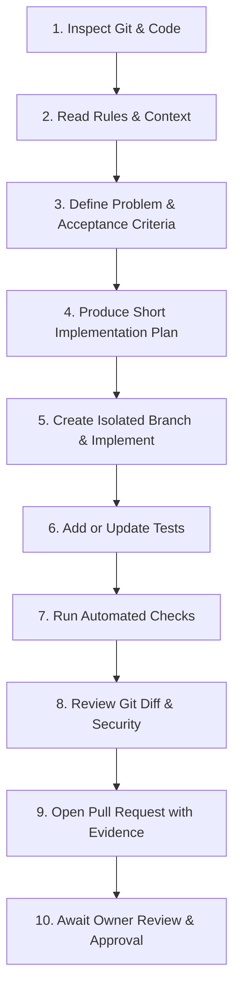

# PitchMint Mobile — Agentic SDLC & Development Lifecycle

This workflow governs every code modification, dependency update, and bug fix in `PitchMint-mobile`.

---

## The 10-Step Development Lifecycle



### Step 1: Inspect Git Status & Relevant Code
- Always run `git status`, `git branch -a`, and inspect recent commits before modifying any code.
- Check whether any uncommitted user work exists. Never overwrite, discard, or stash the owner's uncommitted work.

### Step 2: Read Applicable Repository Rules
- Review `.agents/rules/project.md`, `.agents/rules/architecture.md`, and `.agents/rules/coding.md`.
- Read `PROJECT_CONTEXT.md` for current versions, known limitations, and environment conventions.

### Step 3: Describe the Problem & Acceptance Criteria
- Formulate the exact problem, the affected components, and the clear, measurable acceptance criteria before editing code.

### Step 4: Produce a Short Implementation Plan
- Document the planned file edits, component touchpoints, and expected test additions.
- Ensure the scope remains minimal and strictly bounded.

### Step 5: Implement on an Isolated Branch
- Branch off the primary branch (`main`) using standard prefixes:
  - `feat/` for new features or user capabilities.
  - `fix/` for bug fixes or regressions.
  - `chore/` for tooling, CI, dependencies, or maintenance.
- Keep commits atomic with conventional commit messages (e.g. `chore(ci): configure github actions workflow`).

### Step 6: Add or Update Tests
- Write co-located Jest test cases verifying the new functionality or reproducing and fixing the reported bug.

### Step 7: Run Automated Verification Checks
Execute the standard local verification suite:
```bash
npm run typecheck
npm test
npm run doctor
npx expo export --platform android
```
All checks must pass before proceeding to pull request creation.

### Step 8: Review the Diff
- Run `git diff` and audit every line of modified code:
  - Verify no accidental secret leaks or machine-specific network IPs were committed.
  - Confirm no unnecessary third-party libraries were added.
  - Verify no scope creep or unrelated refactors.

### Step 9: Open a Pull Request with Evidence
- Push the branch to `origin` and open a pull request via `gh pr create` or the GitHub interface.
- Provide a structured description including:
  - Summary of changes and rationale.
  - Exact command outputs and test execution evidence.
  - Security audit and rollback considerations.
  - Relevant limitations or future follow-ups.

### Step 10: Await Owner Review & Explicit Approval
- **NEVER merge autonomously.**
- The project owner must review, evaluate the diff, and approve the PR before merging into `main`.
