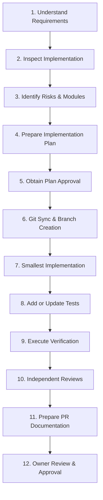

# PitchMint Mobile — Agentic SDLC & Engineering Lifecycle

This workflow governs every code modification, dependency update, and bug fix in `PitchMint-mobile`.

---

## 1. The 12-Step Development Lifecycle



### Step 1: Understand Requirements
- Read user instructions thoroughly. Identify exact acceptance criteria and explicit constraints.

### Step 2: Inspect Existing Implementation
- Verify how the feature, screen, or utility is currently implemented. Avoid assumptions based on memory or past conversations.

### Step 3: Identify Risks & Affected Modules
- Trace side effects across navigation stacks, API clients, authentication lifecycle, or shared theme tokens.

### Step 4: Prepare an Implementation Plan
- Document target files, specific changes, and test strategies in a concise, structured plan.

### Step 5: Obtain Approval for Significant Decisions
- Seek explicit owner approval before architectural changes, payment/billing adjustments, security changes, or dependency additions.

### Step 6: Synchronize Main & Create Feature Branch
- Execute the **Mandatory Git Safety Procedure** (detailed in Section 2 below), including the Graphify freshness check whenever code paths on `main` have changed. Never branch from an outdated feature branch.

### Step 7: Implement the Smallest Appropriate Change
- Write focused, clean code adhering to [`.agents/rules/coding.md`](coding.md). Preserve existing architecture and conventions.

### Step 8: Add or Update Tests
- Write co-located Jest tests covering new behavior, edge cases, and regression prevention.

### Step 9: Execute Relevant Verification
- Run static checks and automated tests locally:
  ```bash
  npm run typecheck
  npm test
  ```

### Step 10: Obtain Independent Reviews Where Useful
- Utilize specialist reviews (Lead Engineer, QA, Security, UI/UX) according to the agent review guidelines in Section 3.

### Step 11: Prepare PR Documentation
- Document summary of changes, exact verification command outputs with exit codes, and technical debt notes.

### Step 12: Wait for Owner Approval Before Merging or Deployment
- **Never merge, deploy, or publish autonomously.** The project owner must review the complete diff and approve.

---

## 2. Mandatory Git Safety Procedure

For every feature branch, execute this exact sequence before making edits:

### Step 1 — Inspect Working Tree
```bash
git status --short --branch
git status --porcelain=v1
```
- If any tracked or untracked changes exist, **STOP immediately and report them**.
- Never stash, reset, overwrite, or delete uncommitted user work.

### Step 2 — Synchronize Main
```bash
git switch main
git pull --ff-only origin main
git status --short --branch
git status --porcelain=v1
```
- If the fast-forward pull fails, `main` cannot be checked out, or the working tree is not clean, **STOP**.

### Step 3 — Verify Graphify Freshness (When Main Code Changed)
Before creating a feature branch, verify whether knowledge graph deliverables in `graphify-out/` are fresh with respect to the latest code changes merged to `main`:

1. **Path Filter Evaluation:**
   Check whether the latest code changes on `main` affect Graphify's configured path filters:
   - `src/**`
   - `package.json`
   - `index.ts`
   - `App.tsx`
   - `tsconfig.json`
   - *Exemptions:* Documentation-only changes (e.g. `*.md`, `docs/**`), CI configuration tweaks (`.github/**` without code path overlap), and unrelated files do not require a Graphify run.

2. **Inspect GitHub Actions Run:**
   If a Graphify run is expected for the source commit on `main`, inspect the latest `Update Graphify Code Graph` workflow run:
   - Do **NOT** create the feature branch while that required Graphify run is queued, pending, or in progress.
   - Confirm the run completed successfully, including both jobs:
     - `extract-graph` ("Extract Knowledge Graph")
     - `commit-graph` ("Commit Knowledge Graph")

3. **Synchronize Graph Deliverables:**
   - Confirm that the generated graph commit, if changes were produced, is present on `main`.
   - Pull `main` again with `git pull --ff-only origin main` to obtain the latest generated graph files (`graphify-out/`).
   - If no graph files changed (e.g. code changes had no AST or structural graph impact), a successful Graphify run will cleanly exit without creating a bot commit; this is normal and expected.
   - Only create the feature branch after `main` has incorporated the latest graph state.

4. **Operational Safeguards & Rules:**
   - **Never Wait Indefinitely:** Never wait indefinitely for a workflow run or invent/presume its execution status.
   - **Authentication / Visibility Fallback:** If GitHub CLI authentication or workflow visibility is unavailable, report the limitation explicitly and ask the repository owner before proceeding with implementation.
   - **No Manual Dispatches:** Never manually dispatch the Graphify workflow (`workflow_dispatch`) for ordinary tasks; preserve the automatic push trigger on `main`.
   - **Preserve Workflow Configurations:** Do not modify `.github/workflows/graphify-update.yml` or Graphify implementation files during feature tasks.

### Step 4 — Check Conflicts & Create Feature Branch
- Check whether the target branch exists locally or remotely:
  ```bash
  git branch -a | grep "<branch-name>"
  ```
- If it already exists, **STOP** and report the conflict.
- Otherwise, create the branch directly from synchronized `main`:
  ```bash
  git switch -c <type>/<descriptive-name>
  ```
- Verify the active branch:
  ```bash
  git branch --show-current
  ```
- Standard branch prefixes:
  - `feat/`: New capabilities.
  - `fix/`: Bug fixes or regressions.
  - `docs/`: Documentation and rule updates.
  - `chore/`: Tooling, CI, dependencies, or maintenance.
- **Never commit directly to `main`.**

---

## 3. Agentic Engineering & Review Model

### Specialist Roles
- **Primary Agent: Lead Engineer**
  - Responsible for investigation, planning, implementation, test writing, and PR preparation.
- **Optional Specialist Reviewers (Independent & Read-Only):**
  - **QA Reviewer:** Audits test coverage, test isolation, mock hygiene, and edge case assertions.
  - **Mobile Security Reviewer:** Audits OWASP MASVS compliance, token lifecycle, secrets leakage, and network cleartext rules.
  - **UI/UX Reviewer:** Audits Arena design fidelity, touch target minimums (48dp/54dp), dark theme tokens, and accessibility labels.

### Subagent Review Safety & Permission Rules
1. **Tool & Sandbox Permission Verification:**
   - **Name and Role Non-Equivalence:** An agent's name, role, prompt, or operating mode does not automatically establish its actual permissions.
   - **No Presumed Read-Only Status:** Never assume a research agent or review subagent is automatically filesystem read-only. The primary agent must explicitly verify actual tool configurations and workspace permissions before delegating any review task.
   - **Least Privilege:** Do not grant broad write or command permissions when review-only access is sufficient.
   - **Fallback on Ambiguity:** If subagent permissions cannot be verified with certainty, the primary agent must conduct the review directly without delegating it.
2. **Concurrence & File Locking:**
   - Never allow multiple agents to modify the same files concurrently.
   - Launch parallel reviews only when tasks are strictly independent, read-only, and staged on a clean commit or established diff.
3. **No Autonomous Agent Creation:**
   - Do not define, register, or invoke persistent custom agent types without explicit user approval.
4. **Mandatory Human Gate:**
   - Human approval remains strictly mandatory for architectural changes, payment/billing adjustments, security decisions, PR merging, and deployment. Never merge or deploy autonomously.
